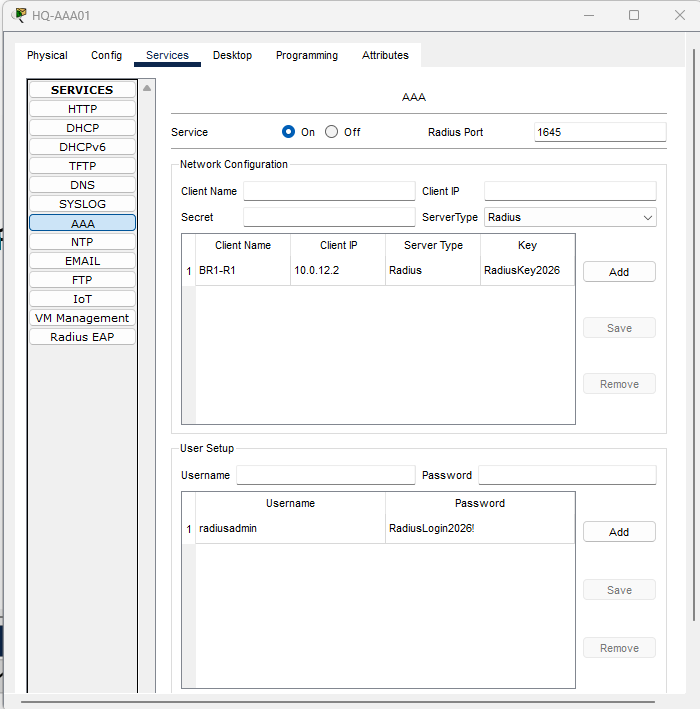
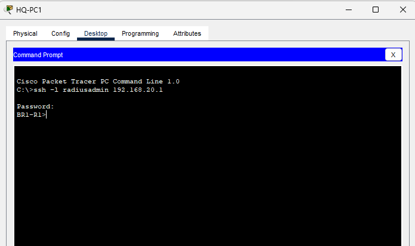
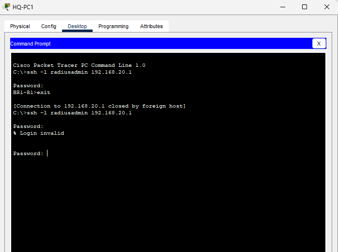
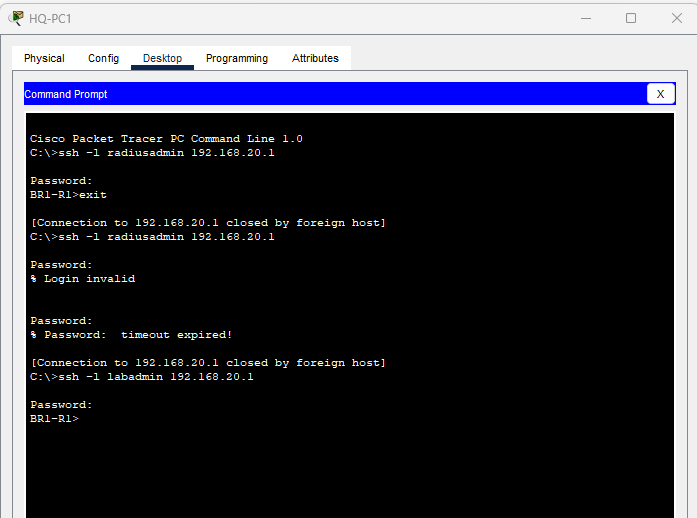
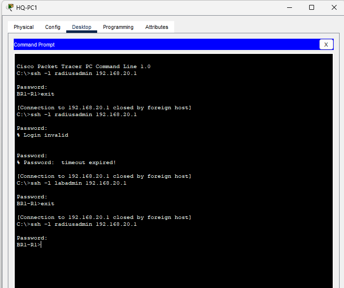
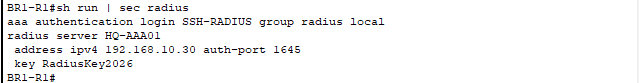
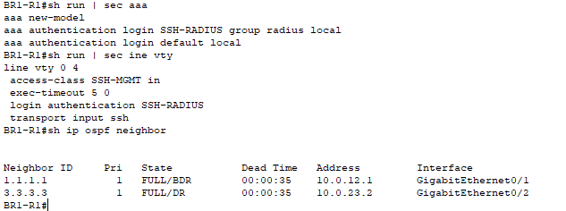

# Multisite AAA RADIUS Authentication

Cisco Packet Tracer lab demonstrating centralized RADIUS authentication for SSH access to a branch router, rejection of invalid credentials, and local authentication fallback during an AAA service outage.

## Objectives

- Authenticate BR1 SSH logins against an HQ RADIUS server.
- Retain the existing restriction allowing SSH only from HQ-PC1.
- Test valid credentials, an incorrect password, server unavailability, and recovery.
- Verify the final AAA configuration and OSPF neighbor health.

## Environment

This lab extends the existing three-site OSPF, ACL, SSH, and syslog/NTP topology in Cisco Packet Tracer. Only BR1 was configured as a RADIUS client in this exercise.

| Component | Address | Role |
| --- | --- | --- |
| HQ-AAA01 | 192.168.10.30/24 | Server-PT with AAA service enabled |
| HQ LAN gateway | 192.168.10.1 | Default gateway for HQ-AAA01 |
| HQ-PC1 | 192.168.10.10 | Permitted SSH management workstation |
| BR1-R1 G0/0 | 192.168.20.1/24 | SSH destination |
| BR1-R1 G0/1 | 10.0.12.2/30 | RADIUS client address registered on server |
| HQ-R1 router ID | 1.1.1.1 | BR1 OSPF neighbor on G0/1 |
| BR2-R1 router ID | 3.3.3.3 | BR1 OSPF neighbor on G0/2 |

HQ-AAA01 connects to an unused HQ switch access port. Reachability from BR1 to 192.168.10.30 was verified before configuring authentication.

## Server Configuration

On **HQ-AAA01 → Desktop → IP Configuration**:

```text
IP address:      192.168.10.30
Subnet mask:     255.255.255.0
Default gateway: 192.168.10.1
```

On **Services → AAA**, enable the service and add:

| Field | Value |
| --- | --- |
| Client name | BR1-R1 |
| Client IP | 10.0.12.2 |
| Server type | RADIUS |
| Shared secret | RadiusKey2026 |
| RADIUS authentication port | 1645 |
| Server username | radiusadmin |
| Server user password | RadiusLogin2026! |

All credentials in this project are disposable lab examples. The shared secret authenticates the router/server relationship; the user password is entered during SSH login.

## BR1 Configuration

The existing local account was retained for fallback:

```text
username labadmin privilege 15 secret LabSSH2026!
```

AAA was configured using the named-server syntax supported by this simulated router:

```text
aaa new-model
aaa authentication login default local
radius server HQ-AAA01
 address ipv4 192.168.10.30 auth-port 1645
 key RadiusKey2026
exit
aaa authentication login SSH-RADIUS group radius local
line vty 0 4
 access-class SSH-MGMT in
 exec-timeout 5 0
 login authentication SSH-RADIUS
 transport input ssh
```

The existing management ACL permits HQ-PC1:

```text
ip access-list standard SSH-MGMT
 permit host 192.168.10.10
 deny any
```

### How the authentication methods work

`SSH-RADIUS` is the named login method list applied to VTY lines 0–4. It tries the RADIUS server group first, then the local user database when RADIUS is unavailable. An explicit RADIUS rejection stops authentication; it does not invoke local fallback. The default login method remains local, and direct console login with labadmin was verified.

This exercise focuses on authentication. Centralized command authorization and accounting were not configured or tested. The observed radiusadmin login reached user EXEC mode (`BR1-R1>`).

## Troubleshooting During Setup

### RADIUS command syntax

The initial `radius-server` command was rejected, including after enabling AAA. Context help showed that this router supports `radius server NAME`. The named-server configuration above was accepted.

### Shared-secret warning

The router issued a type 0 password deprecation warning when the key was entered. The configuration was accepted, but the shared secret remained visible in the running configuration. No stronger key-storage method was demonstrated in this lab.

### SSH attempted from an unapproved PC

An initial SSH attempt from BR1-PC1 was refused. Testing was moved to HQ-PC1, the address permitted by SSH-MGMT, and login succeeded. The management ACL was retained.

### Duplicate server definition

Final configuration review revealed two named RADIUS definitions pointing to 192.168.10.30. The duplicate named `192.168.10.30` was removed:

```text
configure terminal
no radius server 192.168.10.30
end
```

Verification showed only `HQ-AAA01` remaining. A fresh radiusadmin SSH login was reported successful after cleanup.

## Verification Results

Tests were performed from HQ-PC1 using:

```text
ssh -l radiusadmin 192.168.20.1
```

| Test | Action | Observed result |
| --- | --- | --- |
| Centralized login | AAA On; use radiusadmin with the configured password | Login succeeded; BR1-R1 prompt displayed |
| Incorrect password | Use radiusadmin with an intentionally wrong password | `% Login invalid` displayed |
| Local fallback | Turn HQ-AAA01 AAA service Off; SSH as labadmin with its local password | Local login succeeded |
| Server recovery | Turn AAA service On; start a new radiusadmin SSH session | Login succeeded again |
| Final cleanup | Remove duplicate RADIUS definition; repeat radiusadmin login | Login reported successful |
| Routing health | Run show ip ospf neighbor | HQ and BR2 neighbors both FULL |

The `% Password: timeout expired!` visible in the test history followed an unanswered SSH password prompt. It is not a measurement of the RADIUS server timeout or fallback duration.

Final configuration checks:

```text
show running-config | section aaa
show running-config | section radius
show running-config | section line vty
show ip ospf neighbor
```

The running configuration was saved with `copy running-config startup-config`, and the Packet Tracer project was saved with AAA service restored to On.

## Evidence

### 01 — AAA server setup



### 02 — RADIUS login success



### 03 — Incorrect password rejected



### 04 — Local fallback success



### 05 — RADIUS service recovery



### 06 — Final RADIUS server definition



### 07 — AAA, VTY settings, and OSPF health



## Scope and Lessons

- Centralized authentication reduces the need to maintain every administrator account on each router.
- A local fallback account preserves access when the authentication service is unavailable.
- Source restrictions and user authentication are separate controls: valid credentials do not override the management ACL.
- Context help and running-configuration review help resolve platform syntax differences and duplicate configuration.

The outage was simulated by disabling the AAA service, not by failing a WAN link. RADIUS authentication over the OSPF backup path was not tested. Only 10.0.12.2 was registered as a client, and no fixed RADIUS source interface was configured; alternate-path authentication would require validating the request source and server client registration. No packet capture or server-side authentication audit was collected.

## Lab File

Download [multisite-aaa-radius.pkt](multisite-aaa-radius.pkt) and open it in Cisco Packet Tracer. Use HQ-PC1 for SSH tests and BR1's direct CLI for configuration changes.
